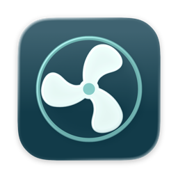
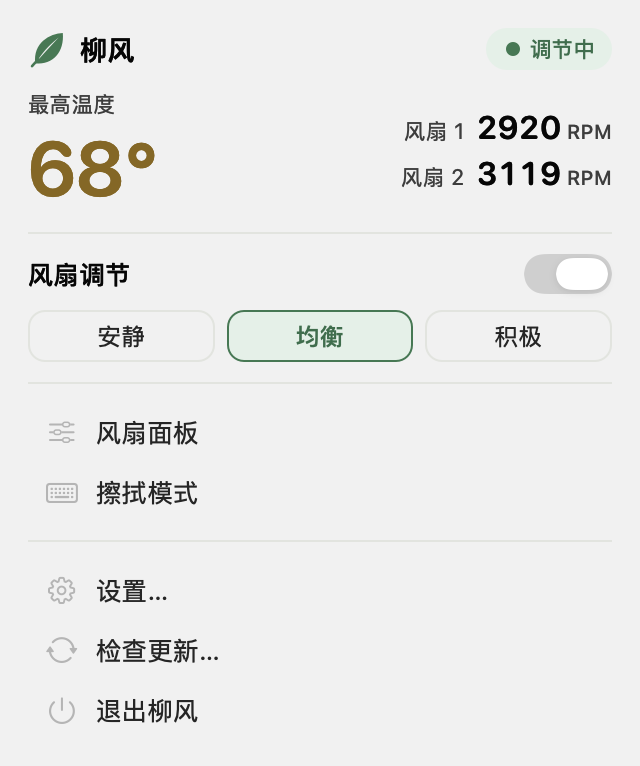
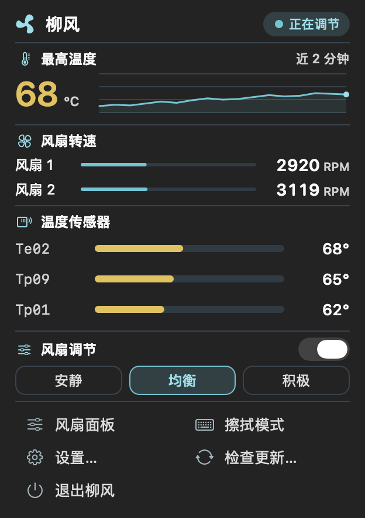

# 柳风 WillowFan



原生 macOS 菜单栏风扇工具，面向带风扇的 Apple Silicon Mac。

- 温度、风扇转速与安静 / 均衡 / 积极三档曲线。
- 单色云朵吹风菜单栏标志，随系统切换浅色与深色。
- 擦拭模式：所有屏幕变黑并屏蔽键盘与鼠标点击。长按 **⌃⌥⌘K 2 秒**退出，5 分钟后自动退出。
- Sparkle 自动检查、下载并安装更新；更新包与更新源均进行 Ed25519 签名校验。

 

## 安装

从 [Releases](https://github.com/ensomnia16/WillowFan/releases/latest) 下载 `WillowFan-*-arm64.zip`，解压后把柳风移到“应用程序”。要求 macOS 13 或更新系统。

首次启用风扇控制时，点击面板中的“安装服务…”，完成系统管理员授权。之后日常调节无需重复输入密码。擦拭模式首次使用时，需要在“系统设置 → 隐私与安全性 → 辅助功能”中允许柳风；如果系统另行要求输入监控，按提示允许后重试。

当前发布包采用本地代码签名，尚未使用 Apple Developer ID 公证。若 macOS 阻止首次打开，可在“系统设置 → 隐私与安全性”中对这次安装选择“仍要打开”；不需要关闭系统安全功能。

## 使用

点击菜单栏风扇图标查看温度、切换曲线、打开风扇面板或进入擦拭模式。关闭风扇调节后恢复系统自动管理。退出应用、应用失去心跳或传感器持续异常时，控制服务也会恢复系统自动模式。

设置中可以管理登录启动、刷新间隔和自动更新。后台更新会下载并验证安装包，在合适时机完成安装；“检查更新…”可立即检查并安装。升级如果包含新的风扇引擎，macOS 会要求授权更新后台服务。

擦拭模式用于清洁键盘与屏幕，不替代 macOS 的身份认证锁屏。只在点击“擦拭模式”后拦截输入，不保存按键内容；显示器变化、用户会话切换或系统睡眠时会退出。

## Xcode 设计预览

用 Xcode 26 或更新版本打开 `WillowFan.xcodeproj`，选 `WillowFan`，按 **⌘R**。预览使用示例数据，可切换调节开关、三档曲线和进程排序；不会安装或写入风扇服务、登录项和真实设置。可从菜单栏打开弹窗，或用 **⌘,** 打开设置。双击 `Assets/WillowFan.icon` 可在 Icon Composer 继续编辑。

## 构建与检查

正式应用沿用发布脚本。需要 Xcode Command Line Tools 和支持 Rust 2024 edition 的 Rust 工具链。Xcode 26 或更新版本会编译分层图标，并生成旧版 macOS 使用的图标资源；旧版工具链使用同色的静态备选图标。

```sh
bash Scripts/test.sh
bash Scripts/build.sh
open build.noindex/柳风.app
```

构建脚本会下载固定版本的 Sparkle 并核验 SHA-256。开发应用和缓存统一存放在 `.noindex` 目录，避免作为多个应用入口出现在 Spotlight 中。正式安装只保留 `/Applications/柳风.app`。

## 发布

更新 `VERSION`、递增 `BUILD_NUMBER`，添加 `docs/releases/<版本>.md`，提交并推送到 GitHub 后运行：

```sh
bash Scripts/release.sh
```

首次在新的维护机器上发布，需要运行 `.deps.noindex/Sparkle/bin/generate_keys --account com.willowfan.app` 生成密钥，并将公钥放入 `UPDATE_PUBLIC_KEY`。现有发布者应迁移原签名密钥，不能随意重新生成。私钥保留在 macOS 钥匙串中，不进入仓库或发布包。脚本生成签名安装包和签名 `appcast.xml`，随后创建 GitHub Release。

## 第三方与设计参考

风扇引擎基于 [Jeamee/macfan](https://github.com/Jeamee/macfan)，保留 [MIT 许可](Engine/LICENSE)。自动更新使用 [Sparkle](https://sparkle-project.org/)，许可见 [ThirdParty/Sparkle-LICENSE](ThirdParty/Sparkle-LICENSE)。本项目新增代码的发布不改变这些第三方许可。

界面规则与所使用的设计 skill、精简 prompt 见 [DESIGN.md](DESIGN.md)。
